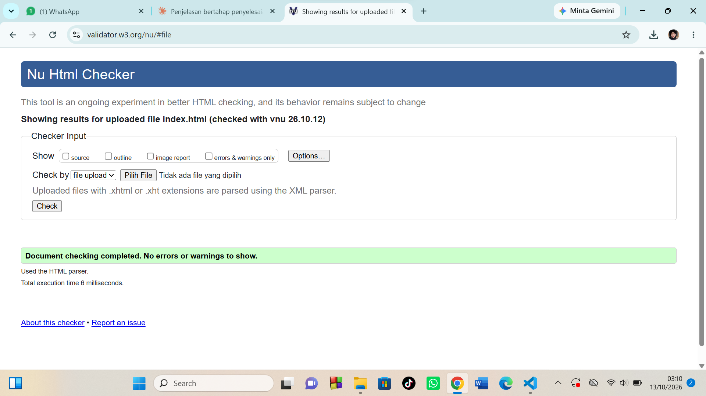

# Tugas Rutin 1 — Landing Page Pribadi

Landing page pribadi yang dibuat dengan HTML5 semantik untuk mata kuliah
Pemrograman Web, UNIMED.

## Fitur
- Struktur semantik: header, nav, main, article, section, aside, footer
- Form interaktif dengan validasi
- Gambar dengan alt dan figcaption
- Heading hierarkis (h1 → h2 → h3)
- Meta tags SEO (title, description, viewport)
- Lolos validasi W3C

## Cara Menjalankan
1. Clone repo ini
2. Buka file `index.html` di browser

## Screenshot

## Pembuat
Selvira
